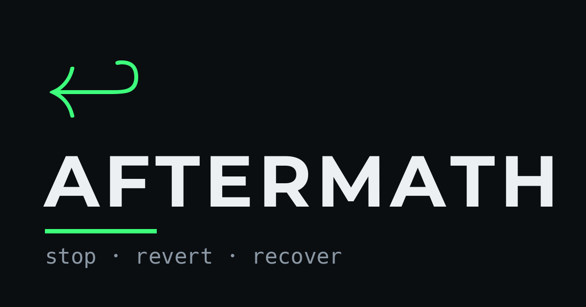

# Aftermath — post-failure recovery skill for AI coding agents

[](https://skills.sh/moah0911/aftermath)
[](LICENSE)



Most agent skills teach how to build. Aftermath teaches how to **stop and recover** when something already broke: a test suite goes green → red, the same error recurs, a build or dependency resolution fails, a test is flaky, a merge conflicts, a destructive command looms, or the user says "you broke it".

<details>
<summary>ASCII banner (terminal)</summary>

```
 ██  ████ █████ ████ ███  █   █  ██  █████ █  █
█  █ █      █   █    █  █ ██ ██ █  █   █   █  █
████ ███    █   ███  ███  █ █ █ ████   █   ████
█  █ █      █   █    █ █  █   █ █  █   █   █  █
█  █ █      █   ████ █  █ █   █ █  █   █   █  █

            stop · revert · recover
```
</details>

## The ladder (`AFTERMATH.md`)

After any failure, stop at the first rung that holds:

1. Uncommitted / one file / cheap to undo? → Revert now. Do not patch forward.
2. Last-known-good exists? → Diff it, isolate one change, revert just that.
3. 2nd+ failed attempt at the same fix? → State exact error, state theory, ask.
4. Next action irreversible? → Confirm state explicitly. Never assume.
5. Filling a gap with a guess? → Say so out loud.
6. User just corrected you? → Do not defend. Find the diff. Fix only that.

Honesty under pressure: never hide a break, never silently revert, never invent an unverified root cause.

## Initialize a project

```bash
npx @moah0911/aftermath init          # detect stack + write .aftermath/config.json
npx @moah0911/aftermath init --dry-run --json
npx @moah0911/aftermath init --run-tests   # also record a baseline (opt-in)
```

Init detects test/build commands, disposable artifacts, and protected paths, then writes
`.aftermath/config.json`. From then on, `rm -rf node_modules` or `rm -rf dist` is allowed
while `rm -rf src`, `.env`, `.git`, and unknown targets stay blocked. It never runs
destructive commands and never enables `autoRevert`.

Full flags, detection matrix, config schema, and policy reasons: [`docs/init.md`](docs/init.md).

```json
{
  "version": 1,
  "defaultMode": "full",
  "autoRevert": false,
  "stacks": ["node"],
  "packageManager": "npm",
  "testCommands": ["npm test"],
  "buildCommands": ["npm run build"],
  "safePaths": ["node_modules", "dist", "coverage"],
  "protectedPaths": [".git", ".env*", "src", "tests", "package.json"],
  "destructiveAllowlist": []
}
```

## What the plugin enforces

- **Destructive commands are blocked** at `full`/`ultra` (force push, reset --hard, clean -f, rm -rf, drop, prune, destroy). `lite` only flags them. `destructiveAllowlist` handles intentional exceptions.
- **Project-aware path policy:** after `aftermath init`, filesystem deletes are allowed only when every target is a literal path under `safePaths` and outside `protectedPaths`. Unknown, dynamic, absolute-outside, or protected targets stay blocked. Claude Code and Codex use the same policy through `PreToolUse`.
- **Forward edits are frozen while a failure is unresolved.** Get a test green, run `/aftermath-revert`, or drop to `lite`/`off`.
- **Ultra checkpoints (opt-in):** snapshot files before edits, mark last-known-good on a green test, restore only matching files on a green→red test. Manual edits become reported conflicts, never overwritten.
- **Detection:** test failures, repeat-error attempt ledger, flaky alternation, build failure, dependency resolution, merge conflicts, and phrase-level correction signals.

| Host | Destructive block | Forward-edit freeze | Checkpoints |
|------|-------------------|--------------------|-------------|
| OpenCode | full/ultra, path-aware | full/ultra | ultra + `autoRevert` |
| Claude Code | PreToolUse, path-aware | — | — |
| Codex | PreToolUse, path-aware | — | — |

## Intensities

| Level | Behavior |
|-------|----------|
| `lite` | Flags the problem, suggests the revert, lets the user decide. No blocks or auto-revert. |
| `full` | Default. Stops forward motion, blocks destructive commands and edits after a failure, runs the diff/isolate diagnostic, asks before the next edit. |
| `ultra` | Same guards as full, plus checkpoint auto-revert when `autoRevert: true`. Reports what was restored and what conflicted. |
| `off` | Disabled. |

Switch with `/aftermath [lite|full|ultra|off]`.

## Configuration

Global: `~/.config/aftermath/config.json` (or `$XDG_CONFIG_HOME/aftermath/config.json`).
Project: `.aftermath/config.json` (written by `aftermath init`; found by walking up to the nearest `.git`).

```json
{
  "defaultMode": "full",
  "autoRevert": true,
  "destructiveAllowlist": ["rm -rf ./dist", "git clean -fd"]
}
```

- `autoRevert` defaults to `false`; it only matters at `ultra`.
- `destructiveAllowlist` entries are command substrings; keep them narrow.
- Project values override scalars; `destructiveAllowlist`, `testCommands`, `buildCommands`, and `protectedPaths` union with global values. `AFTERMATH_DEFAULT_MODE` overrides `defaultMode`.
- `safePaths`/`protectedPaths` power the path-aware destructive policy.

## Slash commands

- `/aftermath [lite|full|ultra|off]` — switch intensity or report state
- `/aftermath-status` — what changed since last-known-good, plus failure/checkpoint state
- `/aftermath-revert` — undo the last change, nothing more
- `/aftermath-audit` — scan the diff for scope creep
- `/aftermath-log` — append a one-line postmortem to `AFTERMATH.log`
- `/aftermath-checkpoint status|clear|restore` — inspect, clear, or manually restore checkpoints
- `/aftermath-init` — initialize the project with destructive-safe paths

## Install

Any agent (skills.sh):

```bash
npx skills add moah0911/aftermath -g -y
```

OpenCode via npm:

```json
{ "plugin": ["@moah0911/aftermath"] }
```

OpenCode via curl:

```bash
curl -fsSL https://raw.githubusercontent.com/moah0911/aftermath/main/scripts/install.sh \
  | bash -s --            # global: plugin + commands + skills
```

Claude Code via marketplace:

```
/plugin marketplace add moah0911/aftermath
/plugin install aftermath@aftermath
```

Or from a clone (same flags, plus `--source` to skip cloning):

```bash
git clone https://github.com/moah0911/aftermath
node aftermath/scripts/install.js            # global: plugin + commands + skills
node aftermath/scripts/install.js --project  # or: wire the current project only
```

Or wire manually:

```json
{ "plugin": ["./.opencode/plugins/aftermath.mjs"] }
```

Then initialize the project:

```bash
npx @moah0911/aftermath init
```

Restart OpenCode after adding. Also works from a checkout on Claude Code / Codex via the lifecycle hooks in `hooks/` — see `docs/agent-portability.md`.

## Layout

```
AFTERMATH.md          # the ladder — always loaded, ~dozen lines
SKILL.md              # root skill entry (discovery pointer)
assets/               # logo.png, icon.png, aftermath.txt (via scripts/make-logo.py)
docs/                 # init/config and agent-portability references
hooks/                # config, instruction builder, signals, checkpoints, policy, host hooks
skills/               # aftermath + 7 failure-category playbooks
commands/             # portable slash commands (mirrored to .opencode/commands/)
.opencode/plugins/    # server plugin (ladder injection + enforcement + tripwires)
scripts/              # init.js, cli.js, install.js, install.sh, consistency checks
tests/                # node:test suite
```

## Verify

```bash
npm test              # full node:test suite
npm run test:coverage # runtime coverage gate (95% lines / 85% branches / 98% funcs)
npm run check         # rule-copy + command sync + version alignment
```

## License

MIT — see `LICENSE`.
